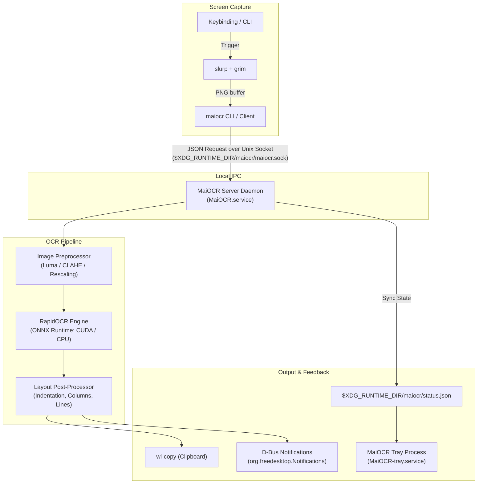

# MaiOCR

> GPU-accelerated screenshot OCR service for Wayland — with a system-tray indicator, persistent settings, and bilingual English / Chinese interface.

MaiOCR allows you to capture any region of your screen, recognise the text inside it (Simplified / Traditional Chinese, English, Japanese, or mixed scripts), preserve visual formatting, and automatically copy the result to your clipboard. The OCR model runs on your NVIDIA GPU with CUDA acceleration whenever available, with automatic and graceful fallback to the CPU.

MaiOCR runs as a lightweight, persistent background daemon: a `systemd` user service hosts the model and serves recognition requests over a Unix-domain socket, an SNI-compliant system-tray process displays live status and quick actions, and customizable desktop keybindings trigger captures seamlessly without window focus disruption.

---

## Table of Contents

- [Highlights](#highlights)
- [Architecture Overview](#architecture-overview)
- [Supported OCR Languages](#supported-ocr-languages)
- [System Requirements & Prerequisites](#system-requirements--prerequisites)
- [Installation & Setup](#installation--setup)
  - [Automated Installation (Arch Linux)](#automated-installation-arch-linux)
  - [Manual / Distro-Agnostic Installation](#manual--distro-agnostic-installation)
  - [Wayland Compositor Keybindings](#wayland-compositor-keybindings)
- [Usage & Common Workflows](#usage--common-workflows)
  - [Triggering OCR](#triggering-ocr)
  - [Service Management](#service-management)
  - [Memory & VRAM Management](#memory--vram-management)
  - [System Tray Indicator](#system-tray-indicator)
  - [Desktop Notifications](#desktop-notifications)
  - [Backward Compatibility](#backward-compatibility)
- [Configuration & Environment](#configuration--environment)
  - [CLI Configuration](#cli-configuration)
  - [Configuration File Options](#configuration-file-options)
  - [Environment Variables](#environment-variables)
- [Project Layout & Development](#project-layout--development)
  - [Directory Structure](#directory-structure)
  - [Development Setup](#development-setup)
  - [Running the Test Suite](#running-the-test-suite)
- [Troubleshooting](#troubleshooting)
- [Security Considerations](#security-considerations)
- [Contributing](#contributing)
- [License](#license)

---

## Highlights

- **NVIDIA GPU Acceleration** — Utilizes `onnxruntime-gpu` with the CUDA execution provider, automatically detected on startup. Gracefully falls back to `CPUExecutionProvider` when a compatible GPU or CUDA runtime is not present.
- **Lazy VRAM & Dynamic Memory Release** — The OCR model is loaded into VRAM only when an actual OCR request arrives. Free GPU memory on demand with `maiocr release-vram`, through the tray icon, or automatically via a configurable idle timer (`auto_release_seconds`).
- **Persistent Daemon Architecture** — A `systemd --user` service keeps the model warm between OCR requests, eliminating cold-start latency for subsequent captures.
- **Layout-Preserving Post-Processing** — The post-processor analyzes bounding boxes to cluster text into visual lines, calculate relative horizontal positions, and reconstruct tabular data, code indentation, columns, and paragraph breaks.
- **Adaptive Image Preprocessing** — Automatically evaluates image contrast and color channels; utilizes YCrCb luma extraction and local adaptive contrast equalization (CLAHE) to handle dark terminal screenshots and syntax-highlighted code without degrading recognition.
- **Non-Focus-Stealing Notifications** — Delivers desktop notifications via the standard freedesktop D-Bus specification (`org.freedesktop.Notifications`). By avoiding creating new Wayland surfaces, it prevents tiling compositors (such as Niri or Sway) from stealing keyboard focus.
- **Wayland System Tray (SNI)** — Status Notifier Item (SNI) tray icon showing real-time engine state (green for GPU, blue for CPU, red for stopped, yellow for transitional). Supports right-click management and customizable single-click and double-click actions.
- **Bilingual Interface** — Seamless toggle between English and Simplified Chinese (`zh-CN`) across CLI output, GUI dialogs, and desktop notifications.
- **Backward Compatible** — Full drop-in compatibility for legacy `wayocr` CLI commands and service references.

---

## Architecture Overview



1. **Trigger & Selection:** Pressing the configured shortcut executes `maiocr run`, which launches `slurp` to let the user select a region, followed by `grim` to capture the selected screen area.
2. **IPC Communication:** The CLI connects to the persistent background server via a Unix domain socket (`$XDG_RUNTIME_DIR/maiocr/maiocr.sock`).
3. **Processing & Inference:** The server preprocesses the image (handling light/dark backgrounds and color contrast), passes it through the lazy-loaded RapidOCR engine, and post-processes bounding boxes into formatted plain text.
4. **Delivery & Status:** The text is piped to `wl-copy`, an asynchronous desktop notification is dispatched via D-Bus, and the system tray reflects the updated service and VRAM status.

---

## Supported OCR Languages

| Script / Language | Status | Details |
|---|---|---|
| **English** | Supported | Default Latin recognition |
| **Simplified Chinese** | Supported | Core default PP-OCRv6 model |
| **Traditional Chinese** | Supported | High accuracy via standard character set |
| **Japanese** | Supported | Kanji, Hiragana, and Katakana support |
| **Mixed Scripts** | Supported | Code snippets, Chinese-English mixed text, numbers, and symbols |

The default model bundled and downloaded by RapidOCR is the **PP-OCRv6** lightweight variant. It provides fast inference times (< 200 ms on modern GPUs) while fitting comfortably within consumer GPU memory footprints.

---

## System Requirements & Prerequisites

### Platform
- **Linux** (primary development and testing on Arch Linux; compatible with other Wayland distributions).
- **Wayland Compositor** exposing `WAYLAND_DISPLAY` (tested on **Niri**, **Sway**, and **Hyprland**).
- **Python >= 3.11**.

### Hardware (Optional Acceleration)
- **NVIDIA GPU** with driver version `>= 535`.
- CUDA (`cuda`) and cuDNN (`cudnn`) libraries installed for GPU execution. If absent, MaiOCR automatically operates in CPU mode.

### External Dependencies

| Package / Command | Role | Distribution Package (Arch Linux) |
|---|---|---|
| `grim` | Screen grabber | `grim` |
| `slurp` | Interactive region selector | `slurp` |
| `wl-clipboard` | Wayland clipboard manager (`wl-copy`) | `wl-clipboard` |
| `libnotify` | Fallback notification utility (`notify-send`) | `libnotify` |
| `qt6-base` | Qt 6 core libraries for system tray | `qt6-base` |
| `qt6-wayland` | Wayland platform plugin for Qt 6 | `qt6-wayland` |
| `python-pyqt6` | Python Qt 6 bindings | `python-pyqt6` |
| `python-dbus` | Native D-Bus bindings for notification spec | `python-dbus` |

---

## Installation & Setup

### Automated Installation (Arch Linux)

For Arch Linux users, an idempotent installer is provided that configures system dependencies, Python tools via `uv`, systemd user services, and desktop integration:

```bash
git clone https://github.com/Melony-mai/wayocr.git
cd wayocr
./scripts/install-arch.sh
```

The script performs the following tasks:
1. Verifies the Arch Linux environment.
2. Installs required system packages (`grim`, `slurp`, `wl-clipboard`, `libnotify`, `qt6-base`, `qt6-wayland`, `python-pyqt6`, `python-dbus`, and optionally `cuda`/`cudnn` if an NVIDIA GPU is detected).
3. Ensures [`uv`](https://docs.astral.sh/uv/) is available and installs the package via `uv tool install --force`.
4. Copies application icons and locale files to `${XDG_DATA_HOME:-$HOME/.local/share}/maiocr/`.
5. Installs and enables `MaiOCR.service` and `MaiOCR-tray.service` under `~/.config/systemd/user/`.
6. Sets up desktop entries under `~/.local/share/applications/`.
7. Links the system PyQt6 and dbus packages into the tool virtual environment.

### Manual / Distro-Agnostic Installation

On other Linux distributions or for custom setups:

1. Install the required system utilities:
   ```bash
   # Debian / Ubuntu (Wayland session)
   sudo apt install grim slurp wl-clipboard libnotify-bin python3-pyqt6 python3-dbus
   
   # Fedora
   sudo dnf install grim slurp wl-clipboard libnotify python3-pyqt6 python3-dbus
   ```

2. Install MaiOCR using `pip` or `uv`:
   ```bash
   git clone https://github.com/Melony-mai/wayocr.git
   cd wayocr
   pip install .
   # or with uv:
   uv tool install .
   ```

3. Enable user systemd units:
   ```bash
   mkdir -p ~/.config/systemd/user
   cp scripts/MaiOCR.service scripts/MaiOCR-tray.service ~/.config/systemd/user/
   systemctl --user daemon-reload
   systemctl --user enable --now MaiOCR.service MaiOCR-tray.service
   ```

### Wayland Compositor Keybindings

Configure your compositor to trigger `maiocr` (or `maiocr run`) on your preferred shortcut:

#### Niri (`~/.config/niri/config.kdl`)
```kdl
binds {
    Mod+Print { spawn "maiocr"; }
}
```
*(Or include the provided snippet: `include "~/.local/share/maiocr/maiocr.niri.kdl"`)*

#### Hyprland (`~/.config/hypr/hyprland.conf`)
```ini
bind = $mainMod, Print, exec, maiocr
```

#### Sway (`~/.config/sway/config`)
```config
bindsym $mod+Print exec maiocr
```

---

## Usage & Common Workflows

### Triggering OCR

| Command | Action |
|---|---|
| `maiocr` | Launches `slurp` region selection, crops via `grim`, extracts text, copies to clipboard, and sends a notification. |
| `maiocr run` | Explicit command alias for running capture OCR. |
| `python main.py` | Direct repository launcher during testing. |

### Service Management

MaiOCR can be managed via `systemctl --user` or through the CLI shortcuts:

```bash
maiocr start          # Start (or restart) the daemon server and system tray
maiocr stop           # Stop both daemon server and tray
maiocr restart        # Restart both server and tray
maiocr status         # Display live service, socket, and engine status
maiocr ping           # Test if the daemon socket is alive and responding
maiocr logs -f        # Stream live daemon logs
maiocr clean-logs     # Rotate and trim server logs immediately
maiocr refresh-tray   # Restart only the tray process (picks up updated binaries)
maiocr repair         # Re-link PyQt6 and D-Bus libraries into tool venv and restart tray
```

You can also use standard `systemctl` commands:
```bash
systemctl --user status MaiOCR.service
systemctl --user restart MaiOCR.service
systemctl --user stop MaiOCR.service
```

### Memory & VRAM Management

Because ONNX Runtime and CUDA can reserve GPU memory, MaiOCR includes on-demand and automatic VRAM unloading:

- **Manual Release:**
  ```bash
  maiocr release-vram
  ```
  Immediately drops the loaded model session from VRAM. The server process remains running, and the next OCR request will lazily reload the model within seconds.
- **Auto-Release on Idle:**
  ```bash
  # Release VRAM automatically if no OCR requests are received for 120 seconds:
  maiocr settings set auto_release_seconds=120
  
  # Or release VRAM immediately after each OCR call:
  maiocr settings set auto_release_vram=true
  ```

### System Tray Indicator

`MaiOCR-tray.service` runs the tray indicator in the background using the standard StatusNotifierItem (SNI) protocol.

#### Indicator Dot Colors:
- **Green:** Service active, model loaded in VRAM (GPU acceleration).
- **Blue:** Service active, model loaded in memory (CPU execution).
- **Red:** Service stopped or daemon unreachable.
- **Yellow:** Idle or transitional state (engine unloaded / waiting for requests).

#### Tray Context Menu (Right-Click):
- **Run OCR screenshot**
- **Release VRAM**
- **Restart MaiOCR**
- **Start / Stop MaiOCR**
- **Service status** (opens detailed status dialog)
- **GPU info** (shows active provider, CUDA device name, driver details)
- **Preferences…** (opens Qt configuration dialog)
- **Quit**

#### Configurable Click Actions:
Left-click and double-click behaviors can be independently assigned:
```bash
maiocr settings set click_action_left=release_vram
maiocr settings set click_action_double=run_ocr
```
Available action IDs: `none`, `release_vram`, `run_ocr`, `show_status`, `show_gpu`, `restart`, `preferences`, `quit`.

### Desktop Notifications

Notifications in MaiOCR follow the freedesktop notification specification over D-Bus (`org.freedesktop.Notifications`).

- **Non-Focus-Stealing Architecture:** MaiOCR avoids creating custom Qt or Wayland notification windows. Instead, your notification daemon (e.g., `mako`, `dunst`, `fnott`, or desktop shell) renders the notification via Wayland `layer-shell`, ensuring tiling compositors do not shift window focus away from your active application.
- **Modes:**
  - `dbus` (alias: `custom`): Direct D-Bus invocation (default and recommended).
  - `system`: Invokes `notify-send` via subprocess.

### Backward Compatibility

For installations migrating from `wayocr`, legacy command shims and services are preserved:
- `wayocr` → Aliased to `maiocr`
- `wayocr-server` → Aliased to `maiocr-server`
- `wayocr-status` → Aliased to `maiocr-status`
- Run `maiocr cleanup` to safely inspect and remove legacy configuration artifacts and old systemd service links.

---

## Configuration & Environment

### CLI Configuration

View and modify persistent settings using `maiocr settings`:

```bash
# Print current settings in JSON format
maiocr settings show

# Change UI language
maiocr settings lang en        # English
maiocr settings lang zh-CN     # Simplified Chinese

# Set individual or multiple configuration parameters
maiocr settings set auto_release_seconds=180 prefer_gpu=true log_level=info
```

### Configuration File Options

Settings are stored in `$XDG_CONFIG_HOME/maiocr/settings.yml` (default: `~/.config/maiocr/settings.yml`):

| Setting Key | Type | Default | Description |
|---|---|---|---|
| `language` | string | `en` | UI language (`en` or `zh-CN`). |
| `prefer_gpu` | boolean | `true` | Attempt GPU acceleration via CUDA; falls back to CPU if unavailable. |
| `auto_release_vram` | boolean | `false` | When `true`, automatically unloads model from VRAM immediately after every capture. |
| `auto_release_seconds` | integer | `0` | Number of idle seconds before unloading model from VRAM (`0` disables timer). |
| `notification_mode` | string | `dbus` | Notification backend: `dbus` (native freedesktop spec) or `system` (`notify-send`). |
| `notification_duration` | integer | `4` | Notification display duration in seconds (1–60). |
| `notify_on_copy` | boolean | `true` | Display a desktop notification when OCR text is copied to clipboard. |
| `click_action_left` | string | `release_vram` | Action triggered on tray icon single left-click. |
| `click_action_double` | string | `run_ocr` | Action triggered on tray icon double-click. |
| `log_level` | string | `info` | Logging verbosity (`debug`, `info`, `warning`, `error`). |
| `log_max_bytes` | integer | `1048576` | Maximum log file size before automatic rotation (1 MB). |
| `log_backup_count` | integer | `3` | Number of rotated backup log files to retain. |
| `log_retention_days` | integer | `7` | Retention limit for log files in days. |

### Environment Variables

MaiOCR honors the standard XDG Base Directory specification and relevant system environment variables:

| Environment Variable | Default Path / Role | Purpose |
|---|---|---|
| `XDG_CONFIG_HOME` | `~/.config` | Base directory for `maiocr/settings.yml`. |
| `XDG_DATA_HOME` | `~/.local/share` | Base directory for icons, desktop entries, and locales. |
| `XDG_RUNTIME_DIR` | `/run/user/<UID>` | Base directory for runtime socket (`maiocr.sock`), status JSON, and logs. |
| `WAYLAND_DISPLAY` | auto-detected | Active Wayland display socket (required for Wayland capture and clipboard). |
| `CUDA_PATH` | `/opt/cuda` | Path to CUDA toolkit installation. |
| `LD_LIBRARY_PATH` | auto-configured in service | Includes `/opt/cuda/lib64:/usr/lib` for CUDA/cuDNN shared object resolution. |

---

## Project Layout & Development

### Directory Structure

```
wayocr / ArchMaiOCR
├── pyproject.toml               # Package build metadata, dependencies, entry points
├── uv.lock                      # Pinned dependency lockfile
├── icon.ico                     # Application icon asset
├── LICENSE                      # MIT License
├── main.py                      # Direct execution entry point
├── README.md                    # Project documentation
├── scripts/
│   ├── install-arch.sh          # Idempotent Arch Linux installation script
│   ├── uninstall-arch.sh        # Complete uninstaller script
│   ├── MaiOCR.service           # systemd user service for background OCR daemon
│   ├── MaiOCR-tray.service      # systemd user service for system tray indicator
│   ├── maiocr.desktop           # Desktop application entry
│   ├── maiocr-tray.desktop      # Desktop autostart entry for tray
│   ├── maiocr.niri.kdl          # Example Niri keybinding configuration
│   └── test-preferences-dialog.sh # Validation test for tray dialogs
├── src/maiocr/
│   ├── __init__.py
│   ├── capture.py               # grim + slurp capture pipeline
│   ├── cleanup.py               # Legacy wayocr cleanup routine
│   ├── cli.py                   # Main CLI command dispatcher
│   ├── client.py                # Unix domain socket client communication
│   ├── clipboard.py             # wl-copy integration
│   ├── compat*.py               # Backward-compatibility shims (wayocr*)
│   ├── gpu.py                   # GPU and CUDA runtime detection
│   ├── i18n.py                  # Internationalization manager
│   ├── logging_utils.py         # Structured logging and rotation
│   ├── notifications.py         # D-Bus & notify-send notification manager
│   ├── notify.py                # Notification helper shim
│   ├── ocr.py                   # RapidOCR engine wrapper (lazy load & VRAM management)
│   ├── paths.py                 # XDG path definitions and runtime paths
│   ├── preprocess.py            # Image preprocessing (CLAHE, YCrCb luma, rescaling)
│   ├── processor.py             # Bounding box clustering & layout-preserving formatter
│   ├── resources.py             # Asset discovery for icons and translation files
│   ├── server.py                # Unix domain socket daemon server
│   ├── settings.py              # YAML settings persistence and dataclass
│   ├── status.py                # Detailed service diagnostics and status reporter
│   ├── system_info.py           # System, GPU, and service diagnostic probes
│   ├── tray.py                  # Qt6 SNI system tray implementation
│   ├── tray_actions.py          # Tray action registry and dispatchers
│   ├── data/                    # Bundled icon assets
│   └── locales/                 # Translation bundles (en.yml, zh-CN.yml)
└── tests/
    ├── conftest.py              # Pytest fixtures and mocks
    ├── test_cleanup.py          # Tests for cleanup utilities
    ├── test_client_server.py    # Tests for socket IPC communication
    ├── test_cli.py              # Tests for CLI argument parsing and handlers
    ├── test_gpu.py              # Tests for GPU detection logic
    ├── test_i18n.py             # Tests for localization strings
    ├── test_logging.py          # Tests for log formatting and rotation
    ├── test_notifications.py    # Tests for D-Bus and notification backends
    ├── test_ocr.py              # Tests for OCR extraction, boxes, and VRAM release
    ├── test_preprocess.py       # Tests for image transformation pipelines
    ├── test_processor.py        # Tests for text layout formatting
    ├── test_resources.py        # Tests for resource resolution
    ├── test_settings.py         # Tests for settings persistence
    ├── test_settings_cli.py     # Tests for settings CLI subcommands
    ├── test_system_info.py      # Tests for system information gathering
    ├── test_tray_actions.py     # Tests for tray action triggers
    ├── test_tray_callbacks.py   # Tests for tray state callbacks
    ├── test_tray_dialog_lifetime.py # Tests for Qt dialog management
    └── test_tray.py             # Tests for system tray initialisation
```

### Development Setup

Clone the repository and set up a virtual environment using `uv`:

```bash
git clone https://github.com/Melony-mai/wayocr.git
cd wayocr

# Create virtualenv and install all dependencies (including dev tools)
uv sync --extra dev

# Activate virtualenv (optional)
source .venv/bin/activate
```

### Running the Test Suite

Run pytest across all unit and integration test suites:

```bash
.venv/bin/pytest
```

All 133 tests should pass without errors.

---

## Troubleshooting

### 1. The service is installed but `maiocr status` says it is inactive
Inspect the systemd user journal:
```bash
journalctl --user -u MaiOCR.service -n 50 --no-pager
```
- **Missing CUDA/cuDNN Libraries:** Ensure `/opt/cuda/lib64` and `/usr/lib` exist. If CUDA is broken, verify `python -c "import onnxruntime; print(onnxruntime.get_available_providers())"`.
- **Socket Permissions:** Ensure `$XDG_RUNTIME_DIR/maiocr` is writable by your user.

### 2. The system tray icon does not appear
Check the tray service logs:
```bash
journalctl --user -u MaiOCR-tray.service -n 50 --no-pager
```
- **PyQt6 Missing in Environment:** Run `maiocr repair` to re-link your system `python-pyqt6` into the tool virtual environment:
  ```bash
  maiocr repair
  ```
- **StatusNotifierItem Host Missing:** Ensure your compositor or bar (e.g., Waybar, DankMaterialShell, Quickshell) has an active StatusNotifierItem / SNI tray host running.

### 3. Notifications do not appear
Verify whether a notification daemon is running:
```bash
pgrep -x mako || pgrep -x dunst || pgrep -x fnott
```
- Verify the active notification backend:
  ```bash
  maiocr settings show | grep notification_mode
  ```
- If no D-Bus notification daemon is available, switch to system notification mode:
  ```bash
  maiocr settings set notification_mode=system
  ```

### 4. `maiocr gpu-info` reports CPU only
- Check NVIDIA driver status:
  ```bash
  nvidia-smi
  ```
- Ensure CUDA and cuDNN packages are installed:
  ```bash
  sudo pacman -S cuda cudnn   # On Arch Linux
  ```
- Restart the service:
  ```bash
  maiocr restart
  ```

### 5. OCR returns empty or inaccurate text
- **Low Contrast / Inverted Background:** The built-in preprocessor adapts to dark themes using CLAHE and luma conversion. If a region has insufficient resolution, select a slightly larger margin around the text.
- **Enable Debug Logs:**
  ```bash
  maiocr settings set log_level=debug
  maiocr restart
  maiocr logs -f
  ```

---

## Security Considerations

- **100% Local Inference:** All OCR processing, image manipulations, and text post-processing are executed entirely on your local machine. No images, telemetry, or text are sent to external servers or cloud APIs.
- **IPC Socket Isolation:** The Unix domain socket is created inside `$XDG_RUNTIME_DIR/maiocr/`, which is assigned permissions `0700` (accessible strictly by the owner UID). No network ports are opened.
- **Volatile Screen Buffers:** Captured screenshots are passed in-memory or written to secure temporary user paths, never permanently persisted to disk unless debug logging is explicitly enabled.

---

## Contributing

Contributions, bug reports, and suggestions are welcome!

1. Fork the repository on GitHub: `https://github.com/Melony-mai/wayocr`.
2. Create a feature branch: `git checkout -b feature/my-feature`.
3. Ensure all tests pass:
   ```bash
   .venv/bin/pytest
   ```
4. Commit your changes with clear, descriptive commit messages.
5. Push to your branch and open a Pull Request.

---

## License

This project is licensed under the [MIT License](LICENSE).  
Copyright (c) 2024-2026 MaiOCR contributors.